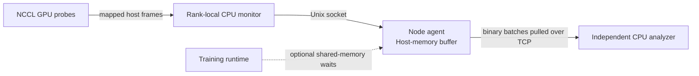

# CCL-D for NCCL

CCL-D for NCCL diagnoses slow and hanging collective operations during
distributed training with GPU progress probes, host monitoring, and an
independent online analyzer. This research implementation builds on NVIDIA
NCCL **v2.24.3-1**. [CCL-D paper](https://doi.org/10.1145/3774934.3786429)

## Quick start

### Build

Use Linux with a CUDA toolkit, a C++ toolchain, and Python 3.9 or later.
The example below builds for H100 (`sm_90`) and uses the CUDA 12.8.2
toolchain exercised in the validation runs.

```bash
git clone https://github.com/GYDmedwin/CCL-D.git
cd CCL-D
make -j8 src.build CUDA_HOME=/usr/local/cuda \
  NVCC_GENCODE='-gencode=arch=compute_90,code=sm_90'
python3 -m unittest discover -s ccld/tests
```

Set `CUDA_HOME` for your toolkit and adjust `NVCC_GENCODE` for your GPU
architecture. The build produces `build/lib/libnccl.so.*`. The upstream
base is commit `6aae37927840b2bd7b7d42d2f0050e75f88ee97f`.
See the [NCCL build options](README.NVIDIA.md#build).

### Example: FSDP model training

Activate your CUDA-enabled PyTorch environment and submit from the repository
root on shared storage. The supplied launcher requests two nodes with eight
GPUs per node. It starts one agent on each training node, runs the analyzer
as a separate process on the batch host, and checks which NCCL library each
rank loaded.

```bash
export CCLD_ROOT="$PWD"
CCLD_PROFILE=smoke sbatch --account YOUR_ACCOUNT --partition YOUR_GPU_PARTITION \
  ccld/slurm/fsdp_train.sh
```

The example trains a synthetic causal decoder with FSDP, bfloat16 and AdamW.
It writes decisions and an event summary to `diagnosis.log` and each rank's
loss, step times, and loaded library to `workload/` under
`runs/fsdp-$SLURM_JOB_ID`. Set `CCLD_RUN` for a custom output directory.
To change the model size or step count, set `CCLD_PROFILE` or `CCLD_STEPS`.

## Use with your training job

Start one agent per training node and start the analyzer on a CPU host that
can reach the agents over the job network. The agents and analyzer use the
same run token. The full launcher commands and tuning options are in the
[online deployment guide](ccld/docs/live.md).

On each training node, launch your existing training command with the node's
agent socket and modified NCCL in the rank environment. For example:

```bash
export CCLD_NCCL_LIB=/path/to/CCL-D/build/lib
export NCCL_CCLD_NODE_SOCKET=/path/to/local/agent.sock
export NCCL_CCLD_ENABLE=1 NCCL_CCLD_MODE=1
export LD_LIBRARY_PATH="$CCLD_NCCL_LIB${LD_LIBRARY_PATH:+:$LD_LIBRARY_PATH}"
export LD_PRELOAD="$CCLD_NCCL_LIB/libnccl.so.2${LD_PRELOAD:+:$LD_PRELOAD}"
```

Keep the agents running until the analyzer drains the final records. Set the
pull interval and buffer size for your workload using the
[retention guide](ccld/docs/live.md#set-the-pull-interval-and-retention).

## What the analyzer reports

The analyzer compares collective timing and progress within a communicator.
It reports slow-operation candidates and classifies hangs from rank progress
and operation metadata.

| Hang class | Evidence used for diagnosis |
|---|---|
| H1 | Prior rank progress shows that one or more ranks have yet to enter the collective. |
| H2 | All ranks have entered. Some complete before the hang threshold while others remain hung, or all hang and a minority has a different operation signature. |
| H3 | All ranks remain hung on a consistent operation, and comparable progress counts identify candidate ranks. |

For **cross-communicator wait attribution**, the training runtime supplies
the exact collective IDs on both sides of an observed wait. For an H1 alert,
this can show why a rank has yet to enter a collective, such as a DP rank
waiting for an earlier TP operation. The analyzer keeps the original
per-communicator alerts so independent issues remain visible. See
[how to register observed waits](ccld/docs/live.md#observe-cross-communicator-waits).

## How it works



The GPU publishes raw progress counters. The host samples progress and
computes metrics, and the analyzer evaluates diagnostic decisions as it
pulls telemetry. See the [telemetry reference](ccld/docs/telemetry.md).

## Validation and experiments

- [16-H100 collective and FSDP checks](RESULTS.md#two-node-collective-and-training-checks)
- [Online Ring hang and Tree slow validation](RESULTS.md#online-release-validation)
- [Single-node Ring S2 checks across three protocols](RESULTS.md#released-online-observer-h100-revalidation)
- [Cross-communicator H1 and wait registration benchmarks](RESULTS.md#cross-domain-h1-over-memory-pull)
- [One-node Ring experiment, offline replay, and fault simulation](ccld/docs/experiments.md)
- [Ordered NCCL patch series](ccld/patches/README.md)

## License and citation

NCCL's license is retained in [LICENSE.txt](LICENSE.txt), NVTX's in
[LICENSE-NVTX.txt](LICENSE-NVTX.txt), and original reproduction additions in
[LICENSE-CCLD.txt](LICENSE-CCLD.txt). See
[THIRD_PARTY_NOTICES.md](THIRD_PARTY_NOTICES.md).

Yida Gu, Fakang Wang, et al., “CCL-D: A High-Precision Diagnostic System for
Slow and Hang Anomalies in Large-Scale Model Training,” PPoPP 2026.
DOI: [10.1145/3774934.3786429](https://doi.org/10.1145/3774934.3786429).
