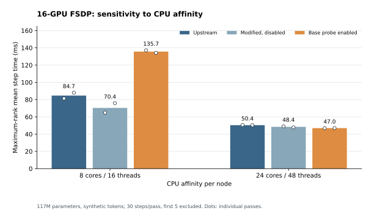

# Historical results and validation boundaries

These are controlled research observations, not a claim that the release is
validated for arbitrary workloads. Raw traces are not included. The export
preserves the selected asynchronous Ring-wait NCCL patch chain; its portable
observer has now been exercised on the limited GPU matrix described below.

## Two-node collective and training checks

On 2026-11-19, the full, non-fault-injection NCCL build was exercised on two
eight-H100 nodes with CUDA 12.8.2 and PyTorch 2.4.1. Every process verified
its mapped NCCL library and runtime version. With Ring/Simple, Ring/LL and
Ring/LL128, AllReduce, AllGather and ReduceScatter each passed six numerical
checks per rank and produced matching completed probe records. Tree AllReduce
passed the same checks with each of the three protocols, including the
topology needed for same-level comparisons. Across these 12 protocol/operation
cases there were 1,152 numerical checks and 1,152 completed rank-operation
records. Each case was run once without injected faults; these are collective
and telemetry checks, not fault-localization accuracy measurements.

A separate two-node AlltoAll run passed 96 numerical checks with the modified
library loaded. PyTorch's `all_to_all_single` used grouped point-to-point
operations in this setup: the traces contained communicator initialization
and heartbeats but no AlltoAll entry, completion, or explicit coverage-gap
record. Its numerical success therefore does not establish AlltoAll probe or
diagnostic coverage; an absent record must not be interpreted as a healthy
AlltoAll operation.

The FSDP example trained a 117,475,328-parameter causal decoder with synthetic
tokens, bfloat16, and AdamW for 20 steps on all 16 GPUs. Each rank had a
nonzero first gradient; the first and last rank-0 losses were 9.190777 and
0.687858. All 320 rank/step loss values matched exactly between upstream NCCL
and the enabled CCL-D build in this run. The enabled run completed 5,440
AllGather, 2,880 ReduceScatter and 32 AllReduce rank-operations, with no
recorded gaps; the live decoder observed a completion during the training
loop. A smaller two-million-parameter, eight-GPU smoke run also had matching
losses and complete traces. These fixed-token tests check execution and run
consistency, not convergence on a real dataset or model quality.

Two additional 16-GPU, 30-step live-analyzer training runs used a 1 ms initial
baseline, a one-second window, two repetitions, and a dynamic baseline after
20 operations. One run produced an S1 decision with no fault deliberately
injected; the other did not reach the repetition threshold. The analyzer's
baseline aggregates heterogeneous FSDP collectives, so these short-window
settings require calibration for a training workload. We do not treat this
no-injection result as a measured general false-positive rate or as proof that
a hardware fault occurred. The separately gated one-shot Ring-wait observer
was not used for the multi-node or mixed-collective training workload.

The table shows a small paired rotation on the 117M model. Each cell is the
average of two runs, where each run averages the maximum rank step time over
the last 25 of 30 steps. The order was upstream, base probe, base plus wait,
base plus wait and live analyzer, then the reverse order. `Base` and `Wait`
write binary traces without a concurrent decoder; `Live` adds the decoder and
base analyzer. These are short exploratory measurements, not an overhead
guarantee or an isolation of the wait-counter cost.

| Placement | Upstream | Base | Wait | Live |
|---|---:|---:|---:|---:|
| 1 node, 8 ranks | 34.51 ms | 32.61 ms | 33.21 ms | 34.31 ms |
| 2 nodes, 4 ranks each | 30.84 ms | 32.98 ms | 34.57 ms | 34.50 ms |
| 2 nodes, 16 ranks | 80.03 ms | 133.28 ms | 123.16 ms | 143.37 ms |

Across these runs all rank/step losses matched the corresponding upstream
run exactly, and trace coverage checks passed. The two eight-rank placements
used the same initial model and per-rank synthetic tokens; their 240
corresponding loss values differed by at most 0.00250. They used separate
allocations, and the two-node eight-rank upstream pass means ranged from 26.56
to 35.12 ms. Thus the observed timing differences are suggestive but do not
isolate a causal mechanism. The 16-rank case also changes the rank count and
global batch. The detailed, sanitized aggregates are in
[fsdp-multinode-validation-20261119.json](ccld/evidence/fsdp-multinode-validation-20261119.json).

To investigate the 16-rank timing, we repeated the same 117M model in a
mirrored rotation with fixed CPU affinity, 30 steps per pass, two passes per
configuration and two hardware threads available per physical core. `Off`
loads the modified library with CCL-D disabled; `Base` enables the base probe
with 512 frames and without the Ring wait counters or live analysis. Each cell
averages the maximum-rank step time after excluding five warmup steps.

| Physical cores per node | Upstream | Modified, off | Base probe |
|---|---:|---:|---:|
| 8 cores, 16 hardware threads | 84.69 ms | 70.39 ms | 135.68 ms |
| 24 cores, 48 hardware threads | 50.41 ms | 48.43 ms | 46.96 ms |

The higher-affinity allocation substantially reduced the observed training
times and the gap between the upstream and base-probe runs. Sampled GPU SM
clocks during active periods were 1,980 MHz in these passes. The results show
sensitivity to available CPU resources and scheduling; they do not isolate
which NCCL, training or monitoring threads are responsible, establish a
general overhead, or rule out other hardware and network effects. With only
two passes per setting, the lower `Base` value in the larger allocation is
not evidence that instrumentation accelerates training. An 8-versus-24-core
rotation with one hardware thread per core showed still stronger sensitivity;
both rotations are retained in the aggregate evidence.
The figure can be regenerated with `ccld/tools/plot_fsdp_cpu.py` and the
aggregate JSON; it requires Matplotlib.

The example Slurm launcher was subsequently rerun on two nodes using 48
allocated logical CPUs per node. All 16 ranks recorded a 48-CPU affinity,
completed ten FSDP steps and produced complete AllGather, ReduceScatter and
AllReduce traces.

We also compared the base probe with 32 versus 512 frame blocks, using the
same model, 16 ranks, a 200 µs poll and two paired passes per setting. The
Ring wait counter and live analyzer were off for this comparison.

| Physical cores per node | 32 frames | 512 frames |
|---|---:|---:|
| 8 cores, 16 hardware threads | 130.71 ms | 151.04 ms |
| 24 cores, 48 hardware threads | 48.87 ms | 53.76 ms |

All eight passes produced complete traces without reported drops and the
training loss checks passed. Linux scheduler counters sampled for threads
present at both ends of the measured interval show the CCL-D threads waiting
to run for an average of 20.88 versus 24.17 ms per rank per step in the
limited-core 32/512-frame cases; at 24 cores the corresponding values were
0.009 versus 0.020 ms. These are sums across monitored threads, not elapsed
communication time, and exclude threads that appeared or exited between
snapshots. The small sample supports CPU scheduling pressure as a contributor;
it does not prove that frame scanning is the only cause or that 32 frames is
sufficient for arbitrary training workloads.

The published FSDP Slurm example was then rerun with its new 32-frame
default, 48 allocated logical CPUs per node and Ring wait counting enabled.
All 16 ranks completed ten steps with matching expected NCCL mappings and
complete traces; the separate AlltoAll numerical smoke also passed.

## Two-node, 16-rank bounded fault checks

The full non-injection NCCL build was also tested with the PyTorch AllReduce
workload and host-side software faults. Each line below is one independent
trial on two nodes, using Simple protocol, a five-second hang threshold, a
0.5-second slow window, and two slow detections before classification.
Faulty S1 ranks slept for one second before each of four operations. H1 ranks
skipped the operation and exited after a bounded wait; these are software
simulations, not hardware failures.

| Algorithm | Scenario and injected rank | Live result |
|---|---|---|
| Ring | no fault | No confirmed alert |
| Ring | S1, rank 2 | S1 with rank 2 as the only candidate |
| Ring | S1, rank 10 | S1 with rank 10 as the only candidate |
| Ring | H1, rank 2 | H1 with rank 2 as the only candidate |
| Tree | H1, rank 10 | H1 with rank 10 as the only candidate |
| Tree | S1, rank 10 | Rank 10 appeared as S1 in some groups, but other groups produced conflicting S2 candidates; no unique overall localization |

For the last case, 42 group decisions reported S1/rank 10, 221 reported S2
and 73 were undetermined; the union of all reported candidates covered all 16
ranks. Those are group-level decisions over multiple operations, not independent
trials. Detection on the observer's own host took 2.12 s in the Ring/S1 case
and 5.15 s in Ring/H1, including the specified thresholds and file polling;
cross-host detection latency was not calculated. The no-fault and S1 trials
each passed 112 rank-operation numerical checks, and both H1 trials passed
all 48 pre-injection checks. These few cases do not replace the planned
five-repeat, multi-protocol and multi-fault matrix.

An optional offline S1-only cross-channel vote was then tested on the Tree
rank-10 trial above and on a separate, restricted Tree-wait build. In the
rank-10 trial it selected the injected rank with 14 votes out of 14 eligible
channels, while all other ranks received zero S1 votes. Three matched
no-injection controls on the Tree-wait build had no confirmed slow alert; six
held-out S1 trials, targeting a leaf and an internal node on a reference
channel three times each, all selected the injected rank 14-to-0. A stronger
simulated S2 trial classified all 112 groups as S2, and the S1-only vote
correctly returned `not_applicable`. These are limited offline observations,
not a validated online or general Tree S2 detector. The stronger S2 test used
a different restricted library from the public training build. Detailed
extension results remain in the research workspace.

Five separate weaker, 5-million-cycle Tree S2 trials on that restricted build
did not trigger the base slow gate, so no S2 localization was evaluated in
those trials. Their host markers record configured injection but do not
directly prove that the device spin executed.

## Released online observer: H100 revalidation

On 2026-11-19, we ran 30 separate single-node, eight-H100 jobs using the
released decoder and online observer. For each Ring protocol, five jobs used a
bounded S2 send-delay injection and five were no-fault controls. The injected
ranks were 0 twice, 1 twice, and 7 once per protocol. Each job ran six
AllReduce operations of 262,144 float32 elements; all 1,440 rank-operation
numerical checks and telemetry validation passed.

| Protocol | S2 faults with correct wait rank | Controls with online alarm | Base slow classification on injected S2 | Controls over threshold when gate forcibly bypassed |
|---|---:|---:|---|---:|
| Simple | 5/5 | 0/5 | S2: 5/5 | 1/5 |
| LL | 5/5 | 0/5 | S3: 5/5 | 0/5 |
| LL128 | 5/5 | 0/5 | S3: 5/5 | 0/5 |

The last column is a separate **offline forced-score** analysis, not an
online false alarm: the normal Simple trial did not pass the confirmed-slow
gate, and the forced score did not produce a majority rank candidate. It shows
that the wait score can cross the old threshold on normal data and should not
be used as an ungated detector. The base analyzer's S3 classifications on LL
and LL128 are incorrect for these pure S2 injections, even though the separate
wait-based rank candidate was correct.

Across the 15 fault jobs, injection-to-first-alert was 1.98–2.09 s and
injection-to-wait-decision was 3.54–3.66 s. These same-host measurements
include trace polling and the configured 1.2-second gaps between operations;
they are not isolated analyzer execution time.

This test used the same restricted-function, fault-enabled library and the
previously fitted `0.6469719382` threshold, a strong 50-million-cycle software
send delay, and the historical 22-channel workload signature. Trials ran on
two H100 hosts, one host per job; this was not a multi-node communicator test.
No Tree, H1/H2/H3, S1/S3 mixed fault, FSDP, weaker fault, or full non-injection
library fault-localization claim follows from this matrix. The aggregate data
are in [online-ring-s2-validation-20261119.json](ccld/evidence/online-ring-s2-validation-20261119.json).

## Synthetic Ring/S2 faults

On one node with eight H100 GPUs, a restricted fault-injection build was
evaluated with a bounded 50-million-GPU-cycle send delay. The threshold was
fit on separate training data and then held fixed; ranks 0, 1 and 7 were held
out for fault validation. Each protocol had one new no-fault control.

| Ring protocol | Held-out S2 faults uniquely located | Control alarms | Injection to live decision |
|---|---:|---:|---:|
| Simple | 3/3 | 0/1 | 3.946–4.102 s |
| LL | 3/3 | 0/1 | 4.125–4.409 s |
| LL128 | 3/3 | 0/1 | 4.190–4.467 s |

All 12 jobs passed their recorded numerical checks. The measurement includes
same-host observation, file polling and configured 1.2-second gaps between
operations. The historical observer required a confirmed base slow diagnosis
and completed operations 4–6. These small, strong synthetic-fault samples
do **not** establish a general accuracy or false-positive rate. The observed
base paper-inspired analyzer's own attribution and classification were not
always correct; the wait result was reported separately.

The historic fitted threshold was about `0.64697`, bound to a specific
restricted fault-enabled library, 8-rank workload, 200 µs polling, data
signature, code hashes and host setup. It is **not** a validated default for
this export or a full non-injection build. Fit and independently validate a
threshold for the intended environment.

## Example overhead observations

These compare the full wait-enabled, no-injection library with upstream NCCL
on one 8-H100 node, Ring/Simple, using five ABBA pairs and 300 nonblocking
iterations per pass. They include the base instrumentation and wait counters.

| Operation and size | In-place elapsed time | Out-of-place elapsed time |
|---|---:|---:|
| AllReduce, 64 MiB | +1.73% | +1.77% |
| AllGather, 64 MiB | +1.61% | +2.12% |
| ReduceScatter, 64 MiB | +1.78% | +1.87% |
| AllReduce, 256 MiB | +1.30% | +1.27% |

This is a limited single-node measurement, not an aggregate or a direct
comparison with the paper's H20 multi-node measurements. The fault-validation
and full performance binaries were different. Waiting-counter iterations are
not elapsed time. Tree wait attribution and multi-node wait localization
accuracy remain unvalidated for this export.

At the 24-channel, 512-frame, 2,048-queue-slot setting used in the full-build
smoke, the base mapped frame was 204,832 bytes per communicator, the optional
mapped wait frame was 196,608 bytes, and queue cells used 4,292,608 bytes of
host memory, excluding other metadata and CUDA event resources. This is a
different configuration from the paper's approximately 1,184-byte frame and
should not be presented as the same per-rank footprint. Diagnostic CPU usage
and general training-step overhead have not been established for this export.

## Differences from the paper

- Earlier tests used one 8-H100 node and CUDA 12.8.2, rather than the
  paper's H20 multi-node setup and CUDA 12.2. The published NCCL base here is
  v2.24.3-1. The Ring-wait rule is an experimental addition, not a stated
  paper algorithm.
- The default completion path polls CUDA events; host-function completion is
  optional. Traces are written as binary records and decoded to JSONL. The
  wait ranking consumes completed operations and therefore cannot itself
  diagnose a kernel that never completes; separate periodic snapshots feed the
  hang analyzer.
- The implementation retains both reciprocal change-count rates and count
  deltas per millisecond. Their interpretation is ambiguous for fixed-window
  samples; neither the base rate heuristic nor the wait rule is a proven
  physical-link root-cause detector.
- H2/H3 GPU faults are bounded simulations or operator-level mismatches, not
  actual hardware failures. Coverage for arbitrary models, overlapping
  operations, capture/replay, and distributed deployments needs further work.

## Export checks

The reconstructed NCCL base tree matches the official v2.24.3-1 tree, and the
ordered patch series applies cleanly. The complete no-injection NCCL library
was built successfully for `sm_90` with CUDA 12.8.2 using eight CPU cores; the
source manifest matched this export. The Python test suite covers trace
decoding, dropped-record handling, base diagnosis and a synthetic live Ring
gate. The refactored normalized Ring score was also compared with the prior
implementation on 1,000 randomly generated valid topologies. These tests are
not a substitute for repeating the GPU validation matrix on this export.
